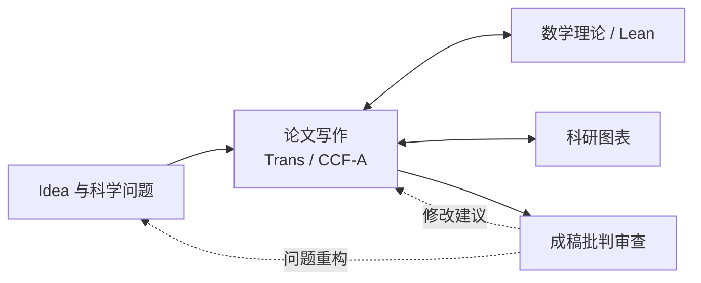
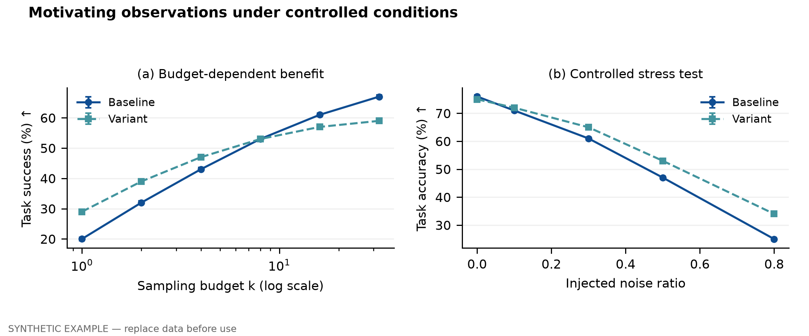
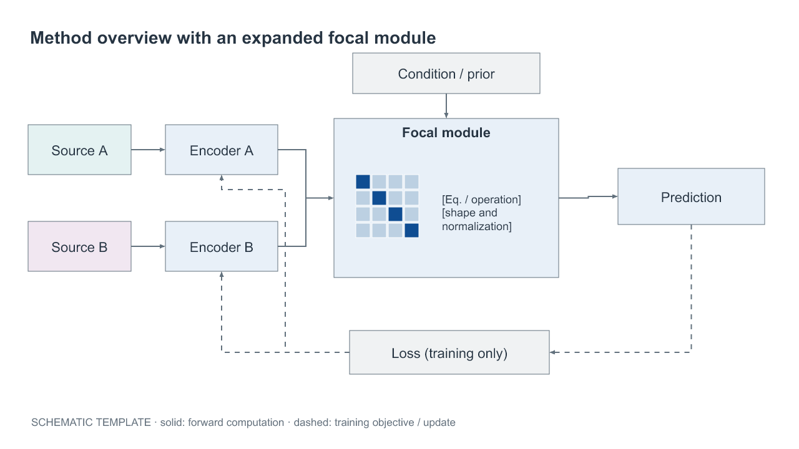
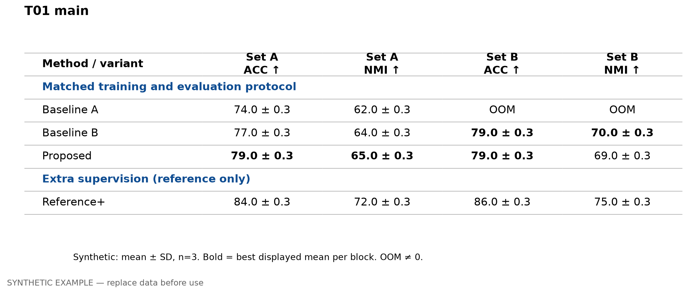
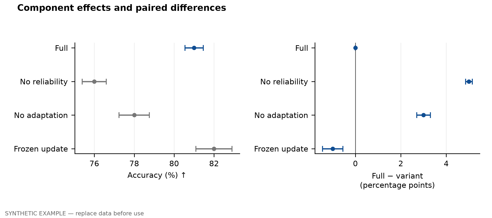

<h1 align="center">Paper-Express</h1>
<p align="center"><strong>从科学问题到严谨论文</strong></p>
<p align="center">把问题审查、论文写作、数学理论、科研图表与成稿批判，组织成可直接调用的 Agent Skills。</p>

<div align="center">


**中文** · [English](README_EN.md)

[快速开始](#quick-start) · [安装](#installation) · [模块索引](#modules) · [图表预览](#previews) · [安装说明](INSTALL.md)

</div>

---

**Paper-Express** 面向需要把研究构想发展为清晰论证、可靠证据和完整论文的科研工作者。它提供一般性的研究与写作方法、可填充的成段模板，以及能实际执行的图表和形式化核验代码。

发布版以 **`paper-express` 一个技能入口**承载五个模块。你可以只审查一个 idea、只写一个章节、只证明一个命题，或让写作模块按需调用理论与图表模块。

## 目录

- [1. 项目定位与工作方式](#overview)
- [2. 快速开始](#quick-start)
- [3. 安装](#installation)
- [4. 五个模块与模板索引](#modules)
- [5. 图表与可编辑模板预览](#previews)
- [6. 运行环境与适用边界](#requirements)
- [7. 开发与验证](#development)
- [8. 来源、致谢与许可](#sources)

<a id="overview"></a>

## 1. 项目定位与工作方式

Paper-Express 以研究问题、核心主张、证据和成立条件为共同上下文，将不同阶段的工作连接起来。

- **研究路径可以不同**：问题、假说、机制、理论与统一框架分别有适用的审查套路。
- **写作直接交付正文**：提供初稿、润色、重写和压缩所需的完整段落模板，并区分期刊与会议的论证安排。
- **理论回到实际方法**：明确假设、命题、证明和算法之间的对应，保留 Lean 的真实执行状态。
- **图表有数据和源文件**：从原始数据生成多种格式，并提供可编辑 PPTX、SVG 与图注模板。
- **审查落实到修改**：每条重要意见对应稿件位置、受影响主张、证据和关闭标准。



这是按需协作关系，五个模块均支持独立调用。跨模块任务沿用同一研究问题、主张编号、稿件版本与证据位置；小任务无需填写完整工作流表单。入口见 [SKILL.md](SKILL.md)，交接方式见 [共用上下文](shared/research-context.md)。

<a id="quick-start"></a>

## 2. 快速开始

安装后，把研究材料与具体任务交给 agent。以下提示词可以直接复制，并附上对应文件或文本：

| 想完成什么 | 可以这样说 |
| --- | --- |
| 审查研究构想 | 使用 paper-express 的 idea 模块，评价这个问题的创新性、重要性和可行性，分别给出问题驱动与理论驱动的完善路线。 |
| 起草期刊论文 | 使用 paper-express 的 writing 模块，按 Trans 路线，根据这些方法定义和真实结果直接起草 Introduction 与 Methods。 |
| 润色会议论文 | 使用 paper-express 的 writing 模块，按 CCF-A 路线润色这版论文，明确正文必须保留的论证与可以放入附录的细节。 |
| 研究数学理论 | 使用 paper-express 的 theory 模块，检查这个命题，明确假设、证明或反例，并在可用环境中生成和核验 Lean 源码。 |
| 制作科研图表 | 使用 paper-express 的 figures 模块，根据这份原始 CSV 制作主结果表和消融图，交付代码、SVG/PDF、统计说明及图注。 |
| 审查成型论文 | 使用 paper-express 的 review 模块，从 TPAMI 视角审查这篇稿件，再加上 best paper 质量检查，给出有定位的意见与修改优先级。 |

材料越接近实际任务，输出越具体。写作提供研究问题、方法和已有结果；理论提供定义、算法与候选命题；绘图提供原始数据和比较协议；审稿提供稿件版本及相关补充材料。尚缺的信息可以明确标注，已知材料不用重复整理。

支持显式技能调用的宿主可以使用 `$paper-express`（Codex）或 `/paper-express`（Claude Code）。也可以直接描述任务，让宿主选择技能。安装版中的 `paper-theory` 等名称是内部模块名称，不是额外注册的命令。

<a id="installation"></a>

## 3. 安装

把本项目的仓库链接、发布包路径或已解压目录交给正在使用的智能体，由它完成安装。**安装技能无需 Python，也无需手动运行安装脚本。**维护源中的发布包位于 `dist/paper-express-3.0.0.zip`。[下载技能 ZIP](https://github.com/Leehowee/paper-express/raw/refs/heads/master/dist/paper-express-3.0.0.zip) · [SHA-256](https://github.com/Leehowee/paper-express/blob/master/dist/paper-express-3.0.0.zip.sha256)。也可提供本地 ZIP 路径或已解压的 `paper-express` 目录。

### 3.1 让 Codex 安装

在 Codex 中发送以下提示词，将来源替换为实际地址或路径：

```text
请将 Paper-Express 安装为我的 Codex 用户级技能。
来源：https://github.com/Leehowee/paper-express

先阅读来源中的 README 和 INSTALL.md。如果提供的是维护源仓库，使用 dist/ 下的发布包。
用系统解压与文件工具取得完整的 paper-express 目录，安装到当前 Codex 实际读取的用户级 skills 目录。
保留全部模块、模板、脚本和资产，确认 SKILL.md 的 name 为 paper-express。
若已有安装，先比较内容；相同则保留，有本地修改则保留修改并报告差异。
按 PACKAGE-MANIFEST.json 核对文件完整性，报告最终安装路径和实际检查结果。
```

Codex 常见用户目录为 `~/.agents/skills/`；已有环境可能使用 `$CODEX_HOME/skills` 或 `~/.codex/skills/`，由智能体检查实际配置并沿用。安装后可发送 `$paper-express` 加上具体任务。目录发现规则见 [Codex 官方说明](https://learn.chatgpt.com/docs/build-skills)。

### 3.2 让 Claude Code 安装

在 Claude Code 中发送：

```text
请将 Paper-Express 安装为我的 Claude Code 用户级技能。
来源：https://github.com/Leehowee/paper-express

先阅读来源中的 README 和 INSTALL.md。如果提供的是维护源仓库，使用 dist/ 下的发布包。
用系统解压与文件工具，将完整的 paper-express 目录放到 ~/.claude/skills/paper-express/。
保留全部模块、模板、脚本和资产，确认 SKILL.md 的 name 为 paper-express。
若已有安装，先比较内容；相同则保留，有本地修改则保留修改并报告差异。
按 PACKAGE-MANIFEST.json 核对文件完整性，并说明如何调用 /paper-express。
```

安装后可发送 `/paper-express` 加上具体任务。Claude Code 的个人技能目录说明见 [官方文档](https://code.claude.com/docs/en/skills)。

### 3.3 项目安装与其他智能体

只在当前论文项目使用时，在提示词中指定“安装为项目级技能”，并提供项目路径。Codex 使用项目内的 `.agents/skills/paper-express/`，Claude Code 使用 `.claude/skills/paper-express/`。

Cursor、Copilot、Gemini CLI、OpenCode 等智能体同样可以按 [安装说明](INSTALL.md) 读取发布包并复制完整目录；也可手动复制。刷新技能列表或重新打开会话，确认出现 `paper-express`。本地目录安装、宿主加载和云端同步是不同状态，按实际检查结果报告。

<a id="modules"></a>

## 4. 五个模块与模板索引

| 模块 | 调用词 | 典型输入 | 直接产出 |
| --- | --- | --- | --- |
| [Idea 与问题审查](paper-idea-review/SKILL.md) | `idea` | 初步构想、已有观察、相关工作、资源约束 | 问题重构、三方面判断、候选路线、最小验证方案 |
| [论文写作](paper-writing/SKILL.md) | `writing` | 方法与结果、目标 venue、提纲或现有稿件 | 可直接使用的章节初稿、润色稿、正文与附录安排 |
| [数学理论与 Lean](paper-theory/SKILL.md) | `theory` | 数学定义、算法、假设、候选命题 | 假设与命题、证明或反例、Lean 源码、验证记录、论文理论段落 |
| [科研图表](paper-figures-tables/SKILL.md) | `figures` | 原始数据、比较协议、方法结构、版面要求 | 绘图与制表代码、矢量图、可编辑模板、图注与数据对应记录 |
| [成稿批判审查](paper-critical-review/SKILL.md) | `review` | 成稿、补充材料、证据文件、上一轮问题清单 | 审稿报告、修改优先级、问题台账与复审结果 |

### 4.1 Idea：从构想到可回答的问题

内置**问题驱动、假说与反常现象驱动、机制驱动、理论驱动、统一框架驱动**五条路径。按主要未知选择路线，分别考察创新性、重要性与可行性，再提出有判别力的最小验证。

可直接使用 [问题审查与重构模板](paper-idea-review/assets/templates/idea-review.md)，或查看 [完整使用示例](paper-idea-review/references/worked-examples.md)。

### 4.2 Writing：Trans 与 CCF-A 两套写法

两条路线各覆盖 **Abstract、Introduction、Related Work、Methods、Experiments、Conclusion、Appendix** 七类写作功能，共 **14 份章节模板文件**，包含成段写法、主线变体与润色示例。

| 路线 | 论证安排 | 模板入口 |
| --- | --- | --- |
| Trans 期刊 | 默认在正文中展开关键推导、设计依据和系统实验分析；附录是按目标期刊要求启用的条件入口 | [章节指导](paper-writing/static/routes/trans/overview.md) · [Methods 模板](paper-writing/assets/templates/trans/methods.md) |
| CCF-A 会议 | 在核实的篇幅限制内保持正文论证完整，详细证明、完整配置与扩展分析放入附录 | [章节指导](paper-writing/static/routes/ccf-a/overview.md) · [Methods 模板](paper-writing/assets/templates/ccf-a/methods.md) |

章节名称可以调整，会议与期刊规则按具体年份及稿件类型核实。Methods 通过 [理论接口](paper-writing/interfaces/theory.md) 和 [图表接口](paper-writing/interfaces/figures-tables.md) 调用相应模块。直接起草与润色的完整演示见 [材料到稿件](paper-writing/references/worked-drafting-example.md)。

### 4.3 Theory：假设、命题、证明与形式化

覆盖可行性与等价性、值函数与正则性、优化与收敛、统计误差与泛化、近似与复杂度五类理论任务。先判断命题是否成立，再组织推导、反例与形式化，最后检查结论是否覆盖实际算法。

提供 [假设与命题模板](paper-theory/assets/templates/theory-contract.md)、[理论写作模板](paper-theory/assets/templates/manuscript-theory.md)、[Lean 工程入口](paper-theory/assets/lean-project/PaperTheory.lean) 和 [验证脚本](paper-theory/scripts/verify_lean.py)。数学推导、Lean 构建、证明依赖与论文语义对应分别记录状态。

### 4.4 Figures：从论证需求到图表成品

覆盖引言实验图、方法路线对比、总体流程、主结果、消融、机制分析、参数敏感性、稳健性、效率与案例展示。

| 随包资源 | 内容与格式 |
| --- | --- |
| 12 个统计图实例 | Python 配置与合成原始数据，附 SVG / PDF / PNG |
| 4 套结果表模板 | 主结果、消融、参数、效率；输出 CSV / Markdown / LaTeX / JSON / SVG / PDF / PNG |
| 6 套示意图模板 | 路线比较、主流程、时序对应、检索案例、能力矩阵与组合布局的 SVG |
| 11 页可编辑 PPTX | 方法示意、5 个原生表格及 1 个带工作簿的原生图表 |

从 [完整模板目录](paper-figures-tables/assets/template-catalog.md) 选择模板；具体执行见 [运行说明](paper-figures-tables/references/running.md)。图表模块既可由写作调用，也可仅凭数据和任务说明独立使用。

### 4.5 Review：从评价到可核验的修改

提供 **Nature、Nature 系列期刊、TPAMI、CCF-A 会议**四类审查视角，并可叠加 **best paper 质量检查**。支持全文、局部内容、理论、实验、图表与修改后复审。

包含 [审稿报告模板](paper-critical-review/assets/templates/reviewer-report.md)、[14 类意见段落套路](paper-critical-review/assets/templates/concern-paragraphs.md)、[修改计划](paper-critical-review/assets/templates/revision-plan.md) 与 [复审报告](paper-critical-review/assets/templates/recheck-report.md)。重要意见说明在哪里、为什么影响主张，以及什么修改或新证据能够解决问题。

<a id="previews"></a>

## 5. 图表与可编辑模板预览

以下预览来自包内模板：统计图和表格使用**合成演示数据**，方法图是**待填充的结构示意**。

| 引言中的受控观察 | 总体方法与核心模块 |
| --- | --- |
|  |  |
| [可编辑 SVG](paper-figures-tables/assets/gallery/F01-motivation.svg) | [可编辑 SVG](paper-figures-tables/assets/native/D02-method.svg) |

| 主实验结果表 | 消融与配对差 |
| --- | --- |
|  |  |
| [LaTeX 表格](paper-figures-tables/assets/gallery/T01-main.tex) | [可编辑 SVG](paper-figures-tables/assets/gallery/F04-ablation.svg) |

[获取 11 页 PPTX 模板](paper-figures-tables/assets/native/paper-figure-table-templates.pptx) · [浏览全部模板](paper-figures-tables/assets/template-catalog.md)

用于论文时，将选定模板复制到研究工作目录，换入真实数据或方法结构，再同步更新图注和结论。手工修改 PPTX 不会自动回写数据或生成代码。

<a id="requirements"></a>

## 6. 运行环境与适用边界

| 任务 | 需要什么 |
| --- | --- |
| Idea 审查、正文起草、理论推导、稿件批判 | 能读取技能文件的 agent；需要核查新文献或投稿规则时使用宿主检索能力 |
| 技能安装 | 智能体的文件读取、系统解压与目录复制能力；无需 Python |
| Python 绘图与制表 | Python 3.12+，依赖见 [requirements.txt](paper-figures-tables/requirements.txt) |
| Lean 核验 | Lean / Lake 与工程锁定的 Mathlib 依赖，详见 [Lean 工作方式](paper-theory/static/lean/workflow.md) |
| 编辑现成 PPTX / SVG | 支持相应格式的编辑器或宿主工具 |
| 重建原生 PPTX | Node.js 与原构建环境提供的 `@oai/artifact-tool`；该库不随包分发。没有该库时可直接编辑现成模板 |

需要运行科研代码时，再让智能体按相应模块准备环境。例如：

```text
请使用 paper-express 的 figures 模块，检查绘图依赖，在独立环境中运行包内合成图表示例，
将输出保存到我的论文工作目录，并报告实际运行结果。
```

模板应保持几项研究边界：未完成实验保留为计划，未核实的新颖性保留为暂定判断，未执行的 Lean 源码保留未运行状态。形式化通过只说明所编码命题通过检查，其假设与实际方法仍需建立对应。审稿模拟与 best paper 检查用于改进研究和表达，不构成录用或获奖预测。

<a id="development"></a>

## 7. 开发与验证

维护源目录为 `paper-skills`，发布包中的安装目录为 `paper-express`。维护源保留各模块的 `SKILL.md`，构建时将五个子入口转换为 `GUIDE.md`，使不同宿主只发现一个注册入口。下图展示发布版的主要结构：

```text
paper-express/
├── README.md / README_EN.md
├── SKILL.md / manifest.yaml
├── INSTALL.md / PACKAGE-MANIFEST.json
├── agents/
├── shared/ / assets/ / references/
├── paper-idea-review/
├── paper-writing/
├── paper-theory/
├── paper-figures-tables/
└── paper-critical-review/
```

扩展时先确定具体使用场景，再更新对应模块、模板与接口。保持中英文 README 的信息一致，保留资源来源和证据状态；新增图表采用明确标注的合成示例或经授权的真实数据。详细模块关系见 [架构说明](architecture.md)。

从**维护源目录**构建发布包：

```sh
python packaging/build_release.py
```

维护者可运行 `python packaging/test_release.py`，在隔离临时目录中检查发布结构、文档链接、清单散列和整包复制后的完整性；该检查不会安装到全局技能目录。构建器检查包内链接并生成 SHA-256 清单。维护工具仅用于构建和验证，发布包可由智能体使用系统文件工具直接安装。

已有检查包括图表数据重算、无效输入拒绝和 PPTX 对象结构；具体范围见 [整体验证记录](references/final-validation.md) 与 [图表验证记录](paper-figures-tables/references/validation.md)。维护源的 `packaging/VALIDATION.md` 保存发布检查结论，临时机器记录写入 `.build/`；后续更新见 [维护说明](https://github.com/Leehowee/paper-express/blob/master/CONTRIBUTING.md)。目录安装验证与宿主 UI 实测分别表述，模板检查也不替代真实论文的实验和证明。

<a id="sources"></a>

## 8. 来源、致谢与许可

Paper-Express 的技能组织、任务路由和文档呈现参考 [nature-skills](https://github.com/Yuan1z0825/nature-skills)，README 的结构参考其 [中文说明](https://github.com/Yuan1z0825/nature-skills/blob/main/README.md) 与 [英文说明](https://github.com/Yuan1z0825/nature-skills/blob/main/README_EN.md)。

研究与写作模板结合用户整理的 Gao Huang、Xinwang Liu、Xi Peng 论文集提炼，将可迁移的论证方式与具体论文的模型、数值和领域假设分开保存：

| 来源方向 | 包内阅读记录 |
| --- | --- |
| 科学问题与 idea 组织 | [Gao Huang 论文分析](paper-idea-review/references/gaohuang-synthesis.md) |
| Trans 期刊写作与数学理论 | [Xinwang Liu 期刊写作分析](paper-writing/references/xinwangliu-analysis.md) · [独作论文理论分析](paper-theory/references/solo-paper-theory.md) |
| CCF-A 会议写作 | [Xi Peng 论文分析](paper-writing/references/xipeng-analysis.md) |
| 科研图表 | [论文图表来源索引](paper-figures-tables/references/source-index.md) · [figures4papers 改编说明](paper-figures-tables/references/upstream-adaptation.md) |

原论文 PDF、原图和上游归档不随发布包分发。包内保留来源定位、阅读分析及必要的许可文件。

上游 Nature Skills 的相关许可文本见 [Apache-2.0 许可副本](paper-critical-review/licenses/nature-skills-LICENSE.txt)。绘图参考来源 [figures4papers](https://github.com/ChenLiu-1996/figures4papers) 的本地快照包含 CC BY-NC 4.0 材料，见 [第三方说明](paper-figures-tables/THIRD_PARTY.md) 与 [许可文本](paper-figures-tables/licenses/figures4papers-CC-BY-NC-4.0.txt)。项目原创内容适用仓库所有者选定的 [MIT 许可证](LICENSE)，第三方材料仍保留各自条款；范围与例外见 [NOTICE.md](NOTICE.md)。
