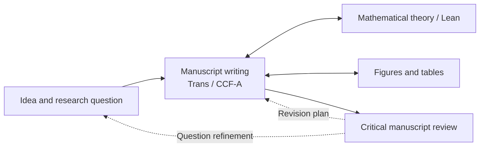
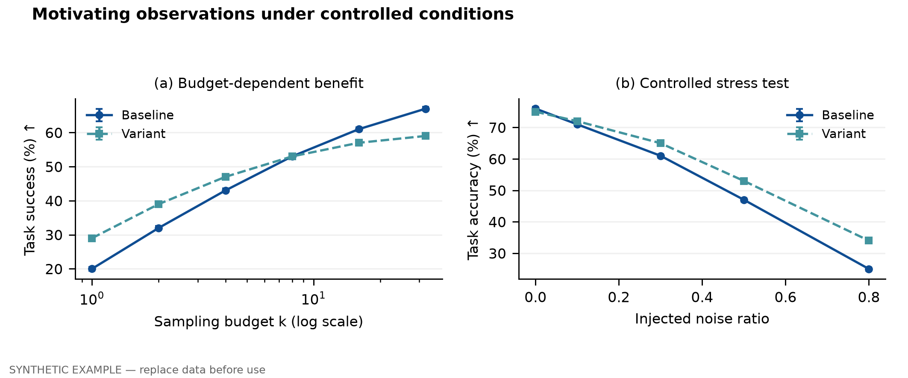
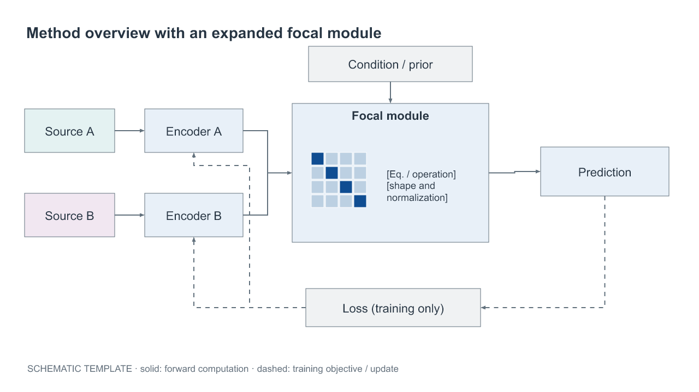
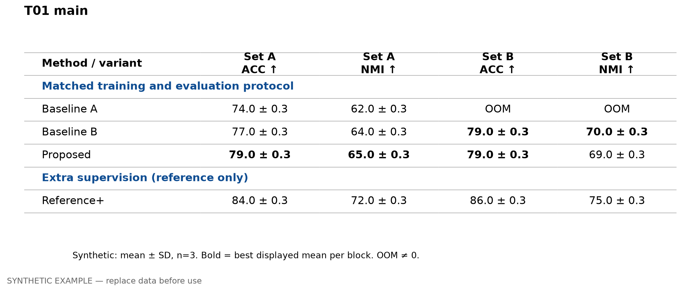
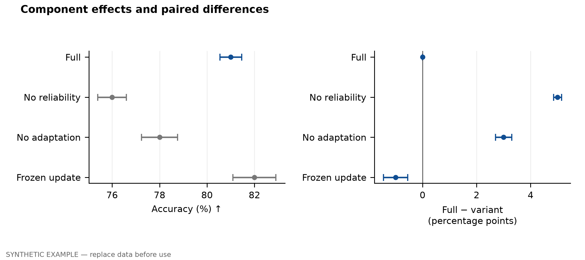

<h1 align="center">Paper-Express</h1>
<p align="center"><strong>From research questions to rigorous papers</strong></p>
<p align="center">Reusable Agent Skills for idea review, manuscript writing, mathematical theory, scientific figures and tables, and critical review.</p>

<div align="center">


[中文说明](README.md) · **English**

[Quick start](#quick-start) · [Installation](#installation) · [Module index](#modules) · [Figure previews](#previews) · [Installation guide](INSTALL.md)

</div>

---

**Paper-Express** helps researchers develop an initial idea into a clear argument, reliable evidence, and a complete manuscript. It combines general research and writing methods with fillable paragraph templates and executable code for figures, tables, and formal verification.

The release exposes **one registered skill, `paper-express`, with five internal modules**. Review a single idea, draft one section, investigate one proposition, or let the writing module call the theory and figure modules when needed.

## Contents

- [1. Purpose and workflow](#overview)
- [2. Quick start](#quick-start)
- [3. Installation](#installation)
- [4. Five modules and their templates](#modules)
- [5. Figure and editable template previews](#previews)
- [6. Requirements and boundaries](#requirements)
- [7. Development and validation](#development)
- [8. Sources, acknowledgments, and licenses](#sources)

<a id="overview"></a>

## 1. Purpose and workflow

Paper-Express connects research tasks through a shared question, central claims, evidence, and conditions under which those claims hold.

- **Different questions need different routes.** Problem, hypothesis, mechanism, theory, and unifying-framework routes have their own review patterns.
- **Writing produces actual prose.** Complete paragraph templates support drafting, polishing, rewriting, and compression, with distinct arrangements for journals and conferences.
- **Theory stays connected to the method.** Assumptions, propositions, proofs, and algorithms are mapped explicitly, with the actual Lean execution status retained.
- **Figures come with data and source files.** Generate multiple formats from raw observations, or adapt editable PPTX, SVG, and caption templates.
- **Review leads to verifiable revisions.** Important comments identify manuscript locations, affected claims, supporting evidence, and criteria for resolving the issue.



These connections are used as needed; every module also works independently. Tasks spanning modules retain the research question, claim identifiers, manuscript version, and evidence locations. Small tasks do not require a full workflow form. See [SKILL.md](SKILL.md) for routing and [shared context](shared/research-context.md) for handoffs.

<a id="quick-start"></a>

## 2. Quick start

After installation, give your agent the relevant materials and a concrete request. Copy one of these prompts and attach the corresponding files or text:

| Task | Example request |
| --- | --- |
| Assess an idea | Use the idea module in paper-express to assess this question's novelty, importance, and feasibility. Suggest both problem-driven and theory-driven ways to refine it. |
| Draft a journal paper | Use the writing module in paper-express, following the Trans route, to draft the Introduction and Methods from these method definitions and actual results. |
| Polish a conference paper | Use the writing module in paper-express, following the CCF-A route, to polish this manuscript and distinguish essential main-text arguments from details suitable for the appendix. |
| Develop mathematical theory | Use the theory module in paper-express to examine this proposition, state its assumptions, and provide a proof or counterexample. Generate and check Lean source if a suitable runtime is available. |
| Make figures and tables | Use the figures module in paper-express to create a main-results table and ablation plot from this raw CSV. Return the code, SVG/PDF outputs, statistical notes, and captions. |
| Review a manuscript | Use the review module in paper-express to assess this manuscript from a TPAMI perspective, then apply the best-paper quality checks. Return located comments and revision priorities. |

Provide materials relevant to the task: the research question, method, and existing results for writing; definitions, algorithms, and candidate propositions for theory; raw observations and comparison protocols for figures; or a manuscript version and supplements for review. Missing information can be marked explicitly. There is no need to reorganize material the agent already has.

Hosts with explicit skill invocation can use `$paper-express` in Codex or `/paper-express` in Claude Code. You can also describe the task and let the host select the skill. Names such as `paper-theory` identify internal modules in this release, not separately registered commands.

<a id="installation"></a>

## 3. Installation

Give your agent this project's repository URL, release archive path, or extracted directory and ask it to install the skill. **Skill installation requires no Python or manually executed installation script.** The maintained source includes the release at `dist/paper-express-3.0.0.zip`. [Download the skill ZIP](https://github.com/Leehowee/paper-express/raw/refs/heads/master/dist/paper-express-3.0.0.zip) · [SHA-256](https://github.com/Leehowee/paper-express/blob/master/dist/paper-express-3.0.0.zip.sha256). You can also provide a local ZIP or an extracted `paper-express` directory.

### 3.1 Ask Codex to install

Send this prompt to Codex, replacing the source with the actual URL or path:

```text
Install Paper-Express as a user-level skill for my Codex environment.
Source: https://github.com/Leehowee/paper-express

Read the source README and INSTALL.md first. For a maintained source checkout, use the release archive under dist/.
Use system extraction and file tools to obtain the complete paper-express folder and place it in the user-level skills directory this Codex environment actually reads.
Retain all modules, templates, scripts, and assets. Confirm that SKILL.md declares name: paper-express.
Compare any existing installation first. Keep identical contents; preserve local modifications and report differences.
Verify the files against PACKAGE-MANIFEST.json, then report the final installation path and actual check results.
```

A common Codex user directory is `~/.agents/skills/`. Existing environments may use `$CODEX_HOME/skills` or `~/.codex/skills/`; have the agent inspect and follow the active configuration. After installation, use `$paper-express` followed by your task. See the [official Codex guide](https://learn.chatgpt.com/docs/build-skills) for discovery rules.

### 3.2 Ask Claude Code to install

Send this prompt to Claude Code:

```text
Install Paper-Express as a user-level skill for Claude Code.
Source: https://github.com/Leehowee/paper-express

Read the source README and INSTALL.md first. For a maintained source checkout, use the release archive under dist/.
Use system extraction and file tools to copy the complete paper-express folder to ~/.claude/skills/paper-express/.
Retain all modules, templates, scripts, and assets. Confirm that SKILL.md declares name: paper-express.
Compare any existing installation first. Keep identical contents; preserve local modifications and report differences.
Verify the files against PACKAGE-MANIFEST.json and explain how to invoke /paper-express.
```

After installation, use `/paper-express` followed by your task. Personal skill locations are documented in the [official Claude Code guide](https://code.claude.com/docs/en/skills).

### 3.3 Project installation and other agents

For one research project, change the prompt to request a project-level skill and supply the project path. Codex uses `.agents/skills/paper-express/` within the project; Claude Code uses `.claude/skills/paper-express/`.

Cursor, Copilot, Gemini CLI, OpenCode, and other agents can likewise follow the [installation guide](INSTALL.md) to read the release and copy the complete directory. Manual copying is also possible. Refresh the skill list or reopen the session and confirm that `paper-express` appears. Report local installation, host discovery, and cloud synchronization as separate states based on actual checks.

<a id="modules"></a>

## 4. Five modules and their templates

| Module | Routing keyword | Typical input | Direct output |
| --- | --- | --- | --- |
| [Idea and question review](paper-idea-review/SKILL.md) | `idea` | Initial idea, observations, related work, resource constraints | Refined question, novelty/importance/feasibility assessment, candidate routes, minimal validation plan |
| [Manuscript writing](paper-writing/SKILL.md) | `writing` | Methods and results, target venue, outline or draft | Usable section drafts, polished prose, main-text and appendix allocation |
| [Mathematical theory and Lean](paper-theory/SKILL.md) | `theory` | Definitions, algorithm, assumptions, candidate propositions | Assumptions and propositions, proofs or counterexamples, Lean source, verification records, theory paragraphs |
| [Scientific figures and tables](paper-figures-tables/SKILL.md) | `figures` | Raw data, comparison protocol, method structure, layout requirements | Plotting and table code, vector outputs, editable templates, captions, data-to-output records |
| [Critical manuscript review](paper-critical-review/SKILL.md) | `review` | Manuscript, supplements, evidence files, previous issue list | Reviewer report, revision priorities, issue ledger, revision recheck |

### 4.1 Idea: turn an idea into an answerable question

Five routes cover **problem-driven research, hypotheses and anomalies, mechanisms, theory, and unifying frameworks**. Choose the route based on the central unknown, assess novelty, importance, and feasibility separately, and design a minimal test that can distinguish competing explanations.

Start with the [idea review and refinement template](paper-idea-review/assets/templates/idea-review.md), or consult the [worked examples](paper-idea-review/references/worked-examples.md).

### 4.2 Writing: separate Trans and CCF-A routes

Each route covers seven writing functions: **Abstract, Introduction, Related Work, Methods, Experiments, Conclusion, and Appendix**. The **14 section-template files** include complete paragraph patterns, narrative variants, and polishing examples.

| Route | Argument structure | Templates |
| --- | --- | --- |
| Transactions journals | Develop the central derivations, design rationale, and systematic experimental analysis in the main text by default. Enable the appendix route when appropriate for the target journal | [Section guidance](paper-writing/static/routes/trans/overview.md) · [Methods template](paper-writing/assets/templates/trans/methods.md) |
| CCF A-ranked conferences | Keep the main argument assessable within verified length limits; use the appendix for detailed proofs, full configurations, and extended analyses | [Section guidance](paper-writing/static/routes/ccf-a/overview.md) · [Methods template](paper-writing/assets/templates/ccf-a/methods.md) |

Section titles are adaptable. Check venue rules for the relevant year and article type. Methods can call the [theory interface](paper-writing/interfaces/theory.md) and [figure interface](paper-writing/interfaces/figures-tables.md). See [materials to manuscript](paper-writing/references/worked-drafting-example.md) for a complete drafting and polishing example.

### 4.3 Theory: assumptions, propositions, proofs, and formalization

Five routes address feasibility and equivalence; value functions and regularity; optimization and convergence; statistical error and generalization; and approximation and complexity. First determine whether the proposition holds, then develop the derivation, counterexample, or formalization and assess its coverage of the implemented algorithm.

Resources include an [assumption and proposition template](paper-theory/assets/templates/theory-contract.md), [theory prose templates](paper-theory/assets/templates/manuscript-theory.md), a [Lean project entrypoint](paper-theory/assets/lean-project/PaperTheory.lean), and a [verification script](paper-theory/scripts/verify_lean.py). Mathematical reasoning, Lean build results, proof dependencies, and correspondence to the manuscript are reported separately.

### 4.4 Figures: turn an evidence need into a figure or table

The module covers introductory experiments, comparisons with previous approaches, method overviews, main results, ablations, mechanism analysis, parameter sensitivity, robustness, efficiency, and case studies.

| Included resources | Contents and formats |
| --- | --- |
| 12 statistical figure examples | Python configurations and synthetic raw data, with SVG / PDF / PNG outputs |
| 4 results-table templates | Main results, ablation, parameters, and efficiency; CSV / Markdown / LaTeX / JSON / SVG / PDF / PNG outputs |
| 6 schematic templates | SVG layouts for method comparison, method overview, temporal correspondence, retrieval cases, capability matrices, and compound figures |
| 11 editable PPTX slides | Method schematics, 5 native tables, and 1 native chart with an embedded workbook |

Choose an asset from the [complete template catalog](paper-figures-tables/assets/template-catalog.md), then follow the [running guide](paper-figures-tables/references/running.md). The module can be called by the writing module or used independently with data and a figure brief.

### 4.5 Review: turn assessment into verifiable revisions

Four perspectives cover **Nature, Nature-family journals, TPAMI, and CCF-A conferences**, with optional **best-paper quality checks**. Review a complete manuscript, selected sections, theory, experiments, figures, or a revised submission.

The module includes a [reviewer-report template](paper-critical-review/assets/templates/reviewer-report.md), [14 concern-paragraph patterns](paper-critical-review/assets/templates/concern-paragraphs.md), a [revision plan](paper-critical-review/assets/templates/revision-plan.md), and a [recheck report](paper-critical-review/assets/templates/recheck-report.md). Important comments identify the issue's location, its effect on the claim, and the revision or additional evidence needed to resolve it.

<a id="previews"></a>

## 5. Figure and editable template previews

These previews use bundled templates: plots and tables contain **synthetic demonstration data**, and the method diagram is a **structural template to be filled in**.

| Controlled observations for an introduction | Method overview and focal module |
| --- | --- |
|  |  |
| [Editable SVG](paper-figures-tables/assets/gallery/F01-motivation.svg) | [Editable SVG](paper-figures-tables/assets/native/D02-method.svg) |

| Main-results table | Ablations and paired differences |
| --- | --- |
|  |  |
| [LaTeX table](paper-figures-tables/assets/gallery/T01-main.tex) | [Editable SVG](paper-figures-tables/assets/gallery/F04-ablation.svg) |

[Get the 11-slide PPTX template](paper-figures-tables/assets/native/paper-figure-table-templates.pptx) · [Browse all templates](paper-figures-tables/assets/template-catalog.md)

Copy the selected template into your research workspace, replace the data or method structure, and update the captions and claims together. Manual edits to the PPTX do not automatically update the data or generation code.

<a id="requirements"></a>

## 6. Requirements and boundaries

| Task | Requirements |
| --- | --- |
| Idea review, manuscript drafting, mathematical reasoning, critical review | An agent that can read the skill files; use the host's search capabilities when checking current literature or venue requirements |
| Skill installation | The agent's file-reading, system extraction, and directory-copy tools; no Python required |
| Python figures and tables | Python 3.12+ and the packages in [requirements.txt](paper-figures-tables/requirements.txt) |
| Lean verification | Lean / Lake and the project's locked Mathlib dependencies; see the [Lean workflow](paper-theory/static/lean/workflow.md) |
| Editing existing PPTX / SVG files | An editor or host tool supporting the relevant format |
| Rebuilding the native PPTX | Node.js and `@oai/artifact-tool` from the original build environment; this library is not distributed. Existing templates can be edited without it |

Ask the agent to prepare the relevant environment when you need to execute research code. For example:

```text
Use the figures module in paper-express to check the plotting dependencies and run the bundled synthetic examples in an isolated environment.
Save the outputs in my research workspace and report the actual execution results.
```

Maintain the distinction between planned and completed experiments, tentative and verified novelty judgments, and unchecked and executed Lean source. Successful formal checking applies to the encoded statement; its assumptions and connection to the actual method still need to be established. Simulated review and best-paper checks support research and revision, not predictions of acceptance or awards.

<a id="development"></a>

## 7. Development and validation

The maintained source directory is `paper-skills`; the installed release directory is `paper-express`. Source modules retain their `SKILL.md` files. The builder converts the five child entrypoints to `GUIDE.md` so hosts discover one registered skill. The main release structure is:

```text
paper-express/
├── README.md / README_EN.md
├── SKILL.md / manifest.yaml
├── INSTALL.md / PACKAGE-MANIFEST.json
├── agents/
├── shared/ / assets/ / references/
├── paper-idea-review/
├── paper-writing/
├── paper-theory/
├── paper-figures-tables/
└── paper-critical-review/
```

When extending the package, start with a concrete use case and update the relevant module, templates, and interfaces. Keep the Chinese and English README versions aligned and preserve source attribution and evidence status. New figure examples should use clearly identified synthetic data or authorized real data. See the [architecture](architecture.md) for module relationships.

Build the release from the **maintained source directory**:

```sh
python packaging/build_release.py
```

Maintainers can run `python packaging/test_release.py` to check release structure, documentation links, manifest hashes, and integrity after copying the complete folder into isolated temporary directories. It does not install into global skills directories. The builder checks local links and generates a SHA-256 inventory. These maintenance tools build and validate the release; agents install the distributed folder directly with system file tools.

Existing checks include recomputing table statistics, rejecting invalid inputs, and inspecting PPTX object structure. Their scope is documented in the [overall validation record](references/final-validation.md) and [figure validation record](paper-figures-tables/references/validation.md). The maintained source records release checks in `packaging/VALIDATION.md`; temporary machine receipts stay in `.build/`. See the [maintenance guide](https://github.com/Leehowee/paper-express/blob/master/CONTRIBUTING.md). Filesystem installation checks are distinguished from live host-UI tests; template validation does not replace experiments or proofs for a real paper.

<a id="sources"></a>

## 8. Sources, acknowledgments, and licenses

Paper-Express draws on [nature-skills](https://github.com/Yuan1z0825/nature-skills) for skill organization, task routing, and documentation presentation. This README's structure references its [Chinese README](https://github.com/Yuan1z0825/nature-skills/blob/main/README.md) and [English README](https://github.com/Yuan1z0825/nature-skills/blob/main/README_EN.md).

The research and writing templates also draw on the user-curated papers of Gao Huang, Xinwang Liu, and Xi Peng. Transferable reasoning patterns are stored separately from paper-specific models, numerical results, and domain assumptions:

| Source area | Bundled reading records |
| --- | --- |
| Scientific questions and idea development | [Analysis of Gao Huang's papers](paper-idea-review/references/gaohuang-synthesis.md) |
| Transactions writing and mathematical theory | [Journal-writing analysis of Xinwang Liu's papers](paper-writing/references/xinwangliu-analysis.md) · [Theory analysis of sole-authored papers](paper-theory/references/solo-paper-theory.md) |
| CCF-A conference writing | [Analysis of Xi Peng's papers](paper-writing/references/xipeng-analysis.md) |
| Scientific figures and tables | [Paper and figure source index](paper-figures-tables/references/source-index.md) · [figures4papers adaptation notes](paper-figures-tables/references/upstream-adaptation.md) |

Original paper PDFs, published figures, and upstream archives are not redistributed in the release. Source locations, reading analyses, and relevant license files are retained.

The relevant upstream Nature Skills license is preserved in the [Apache-2.0 license copy](paper-critical-review/licenses/nature-skills-LICENSE.txt). The local snapshot of [figures4papers](https://github.com/ChenLiu-1996/figures4papers), used as a figure reference, contains CC BY-NC 4.0 material; see the [third-party notes](paper-figures-tables/THIRD_PARTY.md) and [license text](paper-figures-tables/licenses/figures4papers-CC-BY-NC-4.0.txt). Original project material is covered by the repository owner's [MIT License](LICENSE); third-party terms remain in force. See [NOTICE.md](NOTICE.md) for the scope and exceptions.
